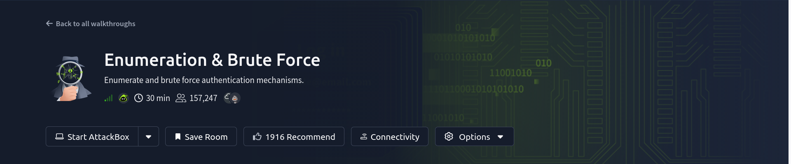
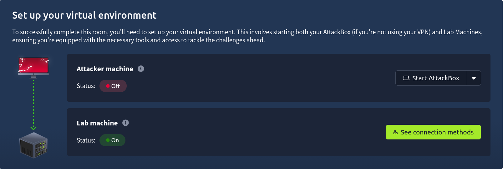
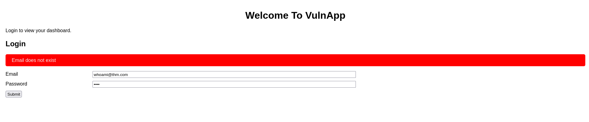

**What is authentication enumeration?**



src: https://tryhackme.com/room/enumerationbruteforce

### Objectives

By the end of this room, you will:

1.  Understand the significance of enumeration and how it sets the stage for effective brute-force attacks.
2.  Learn advanced enumeration methods, mainly focusing on extracting information from verbose error messages.
3.  Comprehend the relationship between enumeration and brute-force attacks in compromising authentication mechanisms.
4.  Gain practical experience using tools and techniques for both enumeration and brute-force attacks.

### Pre-requisites

Before starting this room, you should have a basic understanding of the following concepts:

1.  Familiarity with and HTTPS, including request/response structures and common status codes.
2.  Experience using tools like [](https://tryhackme.com/module/learn-burp-suite).
3.  Basic proficiency in navigating and using the linux commandline.

&nbsp;

# IMPORTANT TERMINOLOGY

## Authentication Security Terminology

| Term | Definition |
| --- | --- |
| Authentication | Verifying the identity of a user |
| Authorization | Determining what an authenticated user can access |
| Enumeration | Gathering information about a system or application |
| Username enumeration | Discovering whether usernames exist |
| Brute force | Systematically testing possible credentials |
| Verbose errors | Error messages that disclose excessive information |
| Password policy | Rules governing acceptable passwords |
| Credential reuse | Using the same credentials across multiple services |
| Rate limiting | Restricting how frequently requests can be made |
| MFA | Using multiple authentication factors to verify identity |

* * *

## Enumeration vs. Brute Force

Enumeration and brute force are related security concepts, but they have different objectives.

| Enumeration | Brute Force |
| --- | --- |
| Discovers information | Tests possible credentials |
| Identifies potentially valid usernames | Attempts to identify passwords |
| Examines application responses | Tests authentication candidates |
| Focuses on information disclosure | Focuses on credential discovery |

# Authentication Enumeration & Verbose Errors

# PART 1 — AUTHENTICATION ENUMERATION

## 1\. Introduction to Authentication Enumeration

**Definition:** Authentication enumeration is the process of examining an application's authentication system to identify information it unintentionally reveals about users, credentials, and authentication requirements.

In simple terms, it involves investigating how a website handles:

- Login
    
- Registration
    
- Password recovery
    
- Session management
    

**Primary objective:** Identify weaknesses in authentication mechanisms and understand how they could compromise application security.

### What can we investigate?

- Does a username or email address exist?
    
- What happens when an incorrect password is entered?
    
- What password requirements are enforced?
    
- How are user sessions managed?
    
- Does the application reveal useful information through error messages?
    
- Are repeated login attempts restricted?
    

&nbsp;

### What exactly are we enumerating?

| Component | What we're investigating |
| --- | --- |
| Username validation | Whether usernames exist |
| Password policies | Password length and complexity requirements |
| Error messages | Information revealed by failed logins |
| Session management | How authenticated sessions are maintained |
| Account lockout | Whether repeated login attempts are restricted |

* * *

## 1.2 Username Enumeration

**Definition:** Username enumeration is the process of determining whether a particular username or email address belongs to an existing account.

### Understanding the vulnerability

Consider an application that returns different responses depending on whether an account exists.

**Example A — Existing account**

```
Username: voldermort
Password: 123456

Response: Incorrect password.
```

**Example B — Non-existing account**

```
Username: randomuser
Password: 123456

Response: Username does not exist.
```

### What did we discover?

The application reveals account information through its authentication responses.

- `voldermort` is likely a registered username.
    
- `randomuser` does not appear to be registered.
    
- The application provides distinguishable responses for different account states.
    

**Security weakness:** The application unintentionally discloses information about registered users.

**Important:** An attacker does not need to know someone's password to determine whether their account exists.

### Where can username enumeration occur?

**A. Registration Pages**

Registration pages allow new users to create accounts.

Example:

```
Username: voldermort

Response: Username already taken.
```

The application reveals that the username is already registered.

- Security weakness: Username enumeration.
    
- Cause: Different responses depending on username availability.
    

**B. Password Reset Features**

Password reset functionality allows users to recover access to their accounts.

Existing account:

```
Email: user@example.com

Response: Password reset email sent.
```

Non-existing account:

```
Response: Email address not registered.
```

The application reveals whether the supplied email address belongs to an existing account.

**Security weakness:** Account enumeration.

**Defence:** Return a consistent response regardless of whether the account exists.

Example:

```
If an account exists with this email address,
password reset instructions will be sent.
```

* * *

## 1.3 Password Policies

**Definition:** A password policy is a set of rules that determines the requirements a password must satisfy before an application accepts it.

### Common password requirements

| Requirement | Description |
| --- | --- |
| Uppercase | At least one capital letter (A–Z) |
| Lowercase | At least one lowercase letter (a–z) |
| Numeric | At least one digit (0–9) |
| Special characters | Characters such as !, @, # and $ |
| Minimum length | A specified minimum number of characters |

### Understanding Regular Expressions (Regex)

**Definition:** Regular expressions are patterns used to search, match, and validate text.

They are commonly used in applications to check whether passwords satisfy particular requirements.

### Example: PHP Password Validation

```
$password = $_POST['pass'];

$pattern = '/^(?=.*[A-Z])(?=.*\d)(?=.*[\W_]).+$/';

if (preg_match($pattern, $password)) {
    echo "Password is valid.";
} else {
    echo "Password is invalid.";
}
```

### Breaking down the regex

| Expression | Meaning |
| --- | --- |
| `^` | Beginning of the string |
| `(?=.*[A-Z])` | Requires at least one uppercase letter |
| `(?=.*\d)` | Requires at least one digit |
| `(?=.*[\W_])` | Requires at least one non-word character or underscore |
| `.+` | Requires at least one character |
| `$` | End of the string |

### What is a Lookahead?

A **positive lookahead** checks whether a particular condition exists somewhere in a string without consuming characters during the match.

Example:

```
(?=.*[A-Z])
```

This checks whether the string contains at least one uppercase letter.

Think of a lookahead as a condition that must be satisfied before the rest of the pattern can match.

### Why does this matter in authentication enumeration?

Applications sometimes reveal password requirements through validation messages.

Example:

```
Password must contain an uppercase letter,
a number and a special character.
```

This reveals information about the application's password policy.

**Important:** The example regex does not enforce a minimum password length beyond requiring at least one character.

* * *

## 1.4 Verbose Authentication Errors

**Definition:** Verbose error messages provide more information than necessary when an application encounters an error.

For example:

```
Username not found.
```

Compared with:

```
Incorrect password.
```

These messages reveal different account states.

**Security weakness:** Information disclosure through authentication responses.

### Defence: Generic Error Messages

Use a consistent authentication error:

```
Invalid username or password.
```

This prevents users from determining whether a username exists through login responses.

* * *

## 1.5 Data Breach Information

**Definition:** A data breach occurs when sensitive or confidential information is accessed, disclosed, or stolen without authorization.

Breached databases may contain:

- Usernames
    
- Email addresses
    
- Passwords or password hashes
    
- Personal information
    
- Other authentication-related data
    

### Credential Reuse

Credential reuse occurs when someone uses the same password across multiple websites or services.

Example:

| Website | Password |
| --- | --- |
| Website A | Cyber123! |
| Website B | Cyber123! |

If Website A suffers a breach, the reused password may put Website B at risk.

### Defences

- Use unique passwords for every account.
    
- Use a reputable password manager.
    
- Enable MFA wherever possible.
    
- Change credentials exposed in a breach.
    

* * *

&nbsp;

* * *

# PART 2 — UNDERSTANDING VERBOSE ERRORS

## 2.1 What Are Verbose Errors?

**Definition:** Verbose errors are detailed error messages that reveal information about what went wrong inside an application.

Developers use them for debugging, but they can accidentally expose sensitive information to users.

Think of verbose errors as clues that reveal details about how an application works internally.

### What information can they reveal?

| Information | Examples |
| --- | --- |
| Internal paths | File locations and directory structures on the server |
| Database details | Database names, table names and column information |
| User information | Usernames and other personal information |

**Main risk:** Verbose errors can expose information that should not be accessible to ordinary users.

* * *

## 2.2 Inducing Verbose Errors

Attackers may interact with an application in unexpected ways to trigger detailed error messages.

### A. Invalid Login Attempts

Submitting incorrect usernames or passwords can produce different error messages.

Example:

```
Username does not exist.
```

Compared with:

```
Incorrect password.
```

These different responses can reveal whether an account exists.

### B. Injection

Injection involves submitting unexpected input into application fields.

For example, improperly handled SQL input might cause a database error that reveals internal database information.

### C. File Inclusion / Path Traversal

Applications that handle file paths incorrectly may reveal internal server directories through error messages.

Example of a directory traversal sequence:

```
../../
```

### D. Form Manipulation

Changing form values or parameters may trigger validation errors that reveal information about how the application processes input.

### E. Application Fuzzing

Fuzzing involves testing an application with unexpected or modified inputs to observe how it responds.

Tools such as **Burp Suite Intruder** can automate input testing.

* * *

## 2.3 The Role of Enumeration and Brute Force

Enumeration and brute force are related techniques used when assessing authentication security.

### User Enumeration

Identifies valid usernames or email addresses.

This reduces uncertainty about which accounts exist.

### Exploiting Verbose Errors

Detailed error messages may reveal information about:

- Account existence.
    
- Password requirements.
    
- Account lockout mechanisms.
    

**Remember:** Verbose errors can provide information that makes further authentication attacks easier.

# Task 1 > Enumeration in Authentication Forms

## 1.) Connection

- I used openvpn to connect to target machine
- ╰─❯ openvpn &lt;name.ovn&gt;



```
╰─❯ ping 10.48.158.176  
PING 10.48.158.176 (10.48.158.176) 56(84) bytes of data.  
64 bytes from 10.48.158.176: icmp\_seq=1 ttl=62 time=279 ms  
64 bytes from 10.48.158.176: icmp\_seq=2 ttl=62 time=410 ms  
64 bytes from 10.48.158.176: icmp\_seq=3 ttl=62 time=429 ms  
64 bytes from 10.48.158.176: icmp\_seq=4 ttl=62 time=452 ms  
64 bytes from 10.48.158.176: icmp\_seq=5 ttl=62 time=373 ms  
^C  
\--- 10.48.158.176 ping statistics ---  
5 packets transmitted, 5 received, 0% packet loss, time 4004ms  
rtt min/avg/max/mdev = 279.078/388.728/452.411/60.702 ms
```

## 2.)Recon

- Site with verbose login is located at
    - [http://enum.thm/labs/verbose\\\_login/](http://enum.thm/labs/verbose%5C_login/)



When you input an invalid email, the website will respond with "Email does not exist." indicating that the email has not been registered yet .However, if the email is already registered, the website will respond with an "Invalid password" error message, indicating that the email exists in the database but the password is incorrect.

I inspected page source to find functions.php So i can point the python automation script that will check for valid email addresses

```
url: 'functions.php',<==  
type: 'POST',  
data: {  
username: username,  
password: password,  
function: "login"  
},
```

```
def check_email(email):
    url = 'http://enum.thm/labs/verbose_login/functions.php'  # Location of the login function
    headers = {
        'Host': 'enum.thm',
        'User-Agent': 'Mozilla/5.0 (X11; Linux aarch64; rv:102.0) Gecko/20100101 Firefox/102.0',
        'Accept': 'application/json, text/javascript, */*; q=0.01',
        'Accept-Language': 'en-US,en;q=0.5',
        'Accept-Encoding': 'gzip, deflate',
        'Content-Type': 'application/x-www-form-urlencoded; charset=UTF-8',
        'X-Requested-With': 'XMLHttpRequest',
        'Origin': 'http://enum.thm',
        'Connection': 'close',
        'Referer': 'http://enum.thm/labs/verbose_login/',
    }
```

&nbsp;

I used a word list of emails names emails.txt to find which emails are valid within the site.

## 3\. Syntax

```
╰─❯ python3 script.py emails.txt
```

The valid email address from the list:


&nbsp;